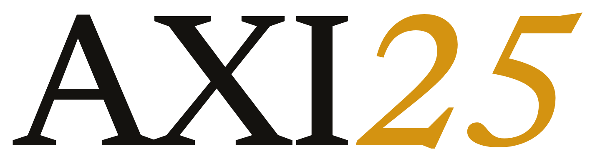

<p align="center">
  <picture>
    <source media="(prefers-color-scheme: dark)" srcset=".build/brand/axi25-banner-dark.png">
    
  </picture>
</p>

<p align="center">
  <strong>The vault-aware Claude chat panel for Obsidian.</strong><br>
  Native AI, skills, and sessions — on your own Claude subscription, inside your vault.
</p>

<p align="center">
  
  
</p>

---

**AXI25** turns Obsidian into an AI workspace: a chat panel that reads your vault, runs your
skills, and drives Claude against your own notes. It ships inside the distributable
[AXI25 vault](https://github.com/felipefontoura/axi25).

It is a **re-branded distribution of [BojuBot](https://github.com/ScottKirvan/BojuBot)**
(MIT, Scott Kirvan). We do not fork the source: the **repo root is the loadable, branded
plugin** and all build tooling lives in [`.build/`](.build). See
[`THIRD-PARTY-NOTICES.md`](THIRD-PARTY-NOTICES.md) for the required MIT attribution.

## Layout

| Path | What |
| --- | --- |
| `main.js` · `manifest.json` · `styles.css` · `data.json` | the loadable Obsidian plugin (repo root) |
| [`.build/apply-brand.mjs`](.build/apply-brand.mjs) | idempotent branding engine — name, icon, artwork, links, `data.json` |
| [`.build/brand/`](.build/brand) | AXI25 artwork (logo, mark, banner) |
| [`THIRD-PARTY-NOTICES.md`](THIRD-PARTY-NOTICES.md) | required MIT attribution |

## Branding

`.build/apply-brand.mjs` rewrites the vendored bundle idempotently:

- **Name** — every visible `BojuBot` → `AXI25`.
- **Icon** — ribbon icon → `square-terminal` (craft aesthetic, not an "AI robot").
- **Artwork** — the real AXI25 wordmark (charcoal `#14120F` + amber `#EDA921`), embedded into `main.js`.
- **Identity** — `manifest.json` name / description / author (`Felipe Fontoura`); `fundingUrl` cleared.
- **Links** — every third-party destination repointed to this repo (only Claude infra remains).
- **Defaults** — `data.json` shipped clean: no stale brand strings, no live session id.

```bash
# after refreshing the vendored BojuBot bundle at the repo root (main.js / manifest.json)
node .build/apply-brand.mjs --dry-run   # preview
node .build/apply-brand.mjs             # apply
```

`DRIFT` warnings flag any target string that moved in a newer upstream build — a quick fix
in the config, never a merge.

## How the vault consumes it

The [AXI25 vault](https://github.com/felipefontoura/axi25) mounts this repo as a **git
submodule** at `.obsidian/plugins/axi25/`, so Obsidian loads the plugin live during
development. At release, the vault's CI assembles a clean copy — verifies the branding,
resets `data.json`, strips `.build/` — into the distributable zip.

## Credits & upstream

Built on **[BojuBot](https://github.com/ScottKirvan/BojuBot)** by Scott Kirvan (MIT) — full
credit to the original project; our changes are branding and packaging only. Rather than only
patch downstream, we proposed a brandable-config feature upstream so any user can white-label
the plugin from settings: [ScottKirvan/BojuBot#286](https://github.com/ScottKirvan/BojuBot/issues/286)
(design in [`.build/UPSTREAM-PROPOSAL.md`](.build/UPSTREAM-PROPOSAL.md)). If it lands, this
repo's branding step retires.

## License

[MIT](LICENSE.md) — © Scott Kirvan (BojuBot). AXI25 branding and packaging by Felipe Fontoura.
